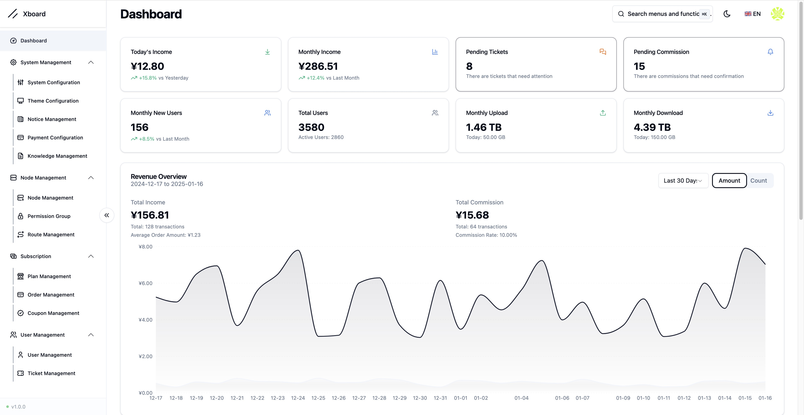
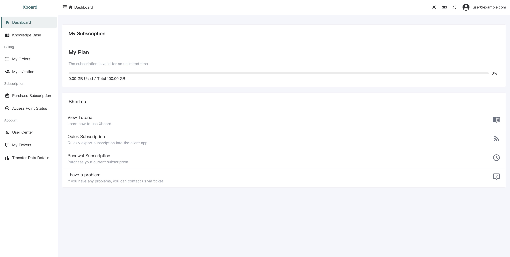

# Xboard

当前独立版本：**2026.10.25.1**。默认内置 NodeEndpoint **1.0.8**、SmartExpiry **1.2.0**、QRCode Extend **1.2.0（审计副本）** 和 FlowScope **2.4.0**；全新安装时自动安装并启用。已有面板升级保留各插件配置、公共 CA 和管理员已有的禁用选择，可显式选择全部启用。

本版修复限速和路由保存后的同步与节点应用问题。已有面板按[本次更新教程](docs/installation/upgrade-2026.10.25.zh-CN.md)操作，分别提供宝塔原生和 aaPanel + Docker 流程；**后端与独立 xboard-node `v1.13-orphan.5` 必须配套升级**。无需卸载插件或重建 CA，不对已有机器重新执行新装/`REPLACE`。在线 WS 节点保存后主动接收更新，HTTP 轮询受原周期影响；正常限速更新保留连接，路由/出站策略更新主动关闭旧流。

宝塔 / aaPanel 原生安装可按 [宝塔安装教程（沿用原教程步骤）](docs/installation/aapanel.zh-CN.md) 操作；权限、归档升级和恢复边界见 [完整安装和升级说明](docs/installation/bundled-native.zh-CN.md)。按教程准备并校验固定 Composer PHAR，完成新网站配置后，在站点目录以 Root 执行；用户名和 PHP 路径以本机为准，命令不传 `--host`：

```bash
bash init.sh --app-user www \
  --php /www/server/php/83/bin/php \
  --composer /opt/xboard-tools/composer-2.10.3.phar \
  --port 8443
```

首次配置时选择 `1` 自动检测本机公网 IPv4（默认，回车选择），或 `2` 手工输入 IP / 域名。自动模式显示候选，回车接受或输入其他实际地址；检测失败必须手工填写。手工模式不请求公网检测服务。已有真实 Root 入口或显式 `--host` 跳过该菜单，不自动覆盖原地址。安装器先准备文件权限，再降权执行 Composer、数据库迁移和插件生命周期，最后处理独立 HTTPS 入口、本机防火墙及公共 CA 导入。Root 工具和私钥位于应用目录之外。

旧教程若已将 `203.0.113.10` 示例 IP 安装为实际入口，按[地址修复说明](docs/installation/bundled-native.zh-CN.md#已有入口误用了文档示例-ip)使用 `--repair-address`；沿用原 CA，为正确地址重签服务器证书并保存设置，不重装面板或重建 CA。

日后在“节点通讯设置”更改 IP 并保存后，在“SSH 配置入口”点击“一键复制 Root 工具命令”，以 Root 通过 SSH 登录这台面板服务器执行。命令使用已保存地址；向导中核对端口和 WS 模式，完成入口修改后回到插件页“验证入口”。网页保存和复制操作不会直接执行 Root 命令。

本版使用 root-installer-v1.0.9 / tools 1.0.6，补齐私有 HTTPS 入口的 FlowScope IPv4 上报路径。全新安装的 Root 计划会包含经过审计的精确 POST 路径。已有入口只升级面板或插件不会自动改写原 Nginx，需在面板服务器以 Root 执行一次：

```bash
curl -fsSL https://raw.githubusercontent.com/ksr-v/Xboard-Independent-NodeEndpoint/root-installer-v1.0.9/install.sh | bash -s -- --refresh-entry
```

原生 HTTPS FPM / Octane 刷新流程保留原 CA、服务器证书、Token 和数据库，不写插件设置或防火墙。标准 Docker 现可使用宿主 Root 自动流程，详见 [Docker 安装与接入教程](docs/installation/aapanel-docker.zh-CN.md)。确认 FlowScope 2.4.0 启用、节点使用独立 Node v1.13-orphan.5 且能访问 IPv4 检测服务；旧 404 最多缓存 10 分钟后自动重报。IPv4 上报不要求 Python 采集器或开启周期流量。

已有面板不要执行全新安装或生成 APP_KEY；使用已校验发行包的 Root 升级工具。四插件无需逐个上传。FlowScope 采集器仍在对应节点机器部署，云安全组需另行放行。原生 FPM 与 Docker 各有独立验证记录；本次 Docker 整套升级流程需先在备份副本演练。

本次修补明确要求 Composer **2.2+**，安装器会在安装依赖前检查版本，并修正首次创建 Composer 缓存时的父目录权限。旧 Composer 的 runtime API 不满足锁定依赖时应指定可信新版 PHAR，保留锁定依赖版本，不执行 `composer update`。

原生部署验证见 [原生测试记录](docs/installation/bundled-validation.zh-CN.md)；本版 Docker 默认 MySQL 安装、重复执行、私有 TLS/WSS、并发设置和权限验证见 [Docker 自动部署记录](docs/installation/aapanel-docker-auto-validation.zh-CN.md)。

<div align="center">


[](LICENSE)

</div>

## 📖 Introduction

Xboard is a modern panel system built on Laravel 11, focusing on providing a clean and efficient user experience.

## ✨ Features

- 🚀 Built with Laravel 12 + Octane for significant performance gains
- 🎨 Redesigned admin interface (React + Shadcn UI)
- 📱 Modern user frontend (Vue3 + TypeScript)
- 🐳 Ready-to-use Docker deployment solution
- 🎯 Optimized system architecture for better maintainability

## 🚀 Installation

Use the [native PHP-FPM guide](docs/installation/bundled-native.zh-CN.md), or the [aaPanel + Docker guide](docs/installation/aapanel-docker.zh-CN.md) ([English](docs/en/installation/aapanel-docker.md)). New Docker installations use `bash docker-install.sh` with aaPanel MySQL/MariaDB and embedded Redis by default, then one reviewed confirmation; SQLite remains optional. Existing standard panels use the host Root `--docker` workflow without reinstalling. Actual tested scope is recorded with the matching Release.

## 📖 Documentation

### 🔄 Upgrade Notice
> 🚨 **Important:** This version involves significant changes. Please strictly follow the upgrade documentation and backup your database before upgrading. Note that upgrading and migration are different processes, do not confuse them.

For this release, follow the [v2026.10.25.1 update guide](docs/installation/upgrade-2026.10.25.zh-CN.md) (Chinese). Upgrade the backend and independent Node `v1.13-orphan.5` together, keeping the original database, `APP_KEY`, machine bindings and private-CA trust.

### Development Guides
- [Plugin Development Guide](./docs/en/development/plugin-development-guide.md) - Complete guide for developing XBoard plugins

### Deployment Guides
- [Deploy with 1Panel](./docs/en/installation/1panel.md)
- [Deploy with Docker Compose](./docs/en/installation/docker-compose.md)
- [Deploy with aaPanel](./docs/en/installation/aapanel.md)
- [宝塔 / aaPanel + Docker](./docs/installation/aapanel-docker.zh-CN.md) / [English](./docs/en/installation/aapanel-docker.md)（新装一次确认；标准桥接布局支持宿主 Root 私有入口，见支持范围）

### Migration Guides
- [Migrate from v2board dev](./docs/en/migration/v2board-dev.md)
- [Migrate from v2board 1.7.4](./docs/en/migration/v2board-1.7.4.md)
- [Migrate from v2board 1.7.3](./docs/en/migration/v2board-1.7.3.md)

## 🛠️ Tech Stack

- Backend: Laravel 11 + Octane
- Admin Panel: React + Shadcn UI + TailwindCSS
- User Frontend: Vue3 + TypeScript + NaiveUI
- Deployment: Docker + Docker Compose
- Caching: Redis + Octane Cache

## 📷 Preview




## ⚠️ Disclaimer

This project is for learning and communication purposes only. Users are responsible for any consequences of using this project.

## ❤️ Support The Project

If this project has helped you, donations are appreciated. They help support ongoing maintenance and would make me very happy.

TRC20: `TLypStEWsVrj6Wz9mCxbXffqgt5yz3Y4XB`

## 🌟 Maintenance Notice

This project is currently under light maintenance. We will:
- Fix critical bugs and security issues
- Review and merge important pull requests
- Provide necessary updates for compatibility

However, new feature development may be limited.

## 🔔 Important Notes

1. Restart required after modifying admin path:
```bash
docker compose restart
```

2. For aaPanel installations, restart the Octane daemon process

## 🤝 Contributing

Issues and Pull Requests are welcome to help improve the project.

## 📈 Star History

[](https://starchart.cc/cedar2025/Xboard)
