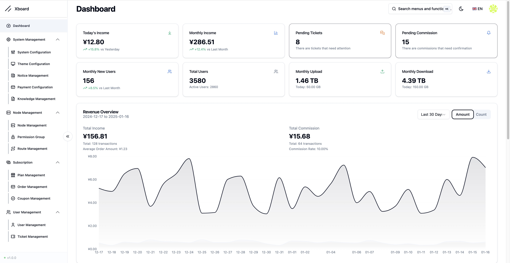
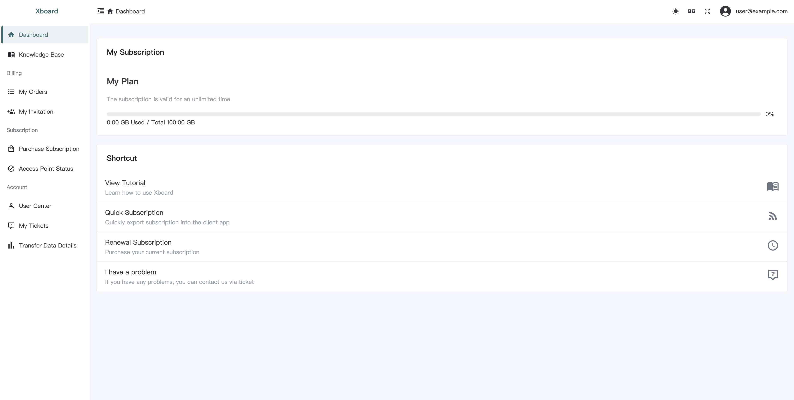

# Xboard

**2026.11.01.1** 固化生产流量队列的 `simple` 固定分配，原生默认三个队列各一个 worker，并保留 `HORIZON_DATA_PIPELINE_MAX` 显式覆盖。教程补齐 PHP 8.3 OPcache 的扩展安装、参数和实际 FPM 验证。新站使用[本版全新安装教程](docs/installation/install-2026.11.01.1.zh-CN.md)，已有站点使用[本版原生升级说明](docs/installation/upgrade-2026.11.01.1.zh-CN.md)，版本变化见[发行说明](docs/releases/v2026.11.01.1.md)。

本版默认内置 NodeEndpoint **1.1.3**、SmartExpiry **1.2.0**、QRCode Extend **1.3.1**、FlowScope **2.4.0** 和 SubInfoCustomizer **1.0.1**，全新安装自动安装并启用五项。安装教程固定下载 `v2026.11.01.1` 的正式归档，并单独核对 `xboard.tar.gz` 的摘要，随后配置网站、节点通讯入口、定时调度和队列守护。

本发行提供完整原生源码归档和校验资产，按既有备份及维护流程部署；OPcache 扩展仍须在 aaPanel 的实际 PHP 8.3 中另行安装。已验证的现场队列切换不代表本次完整归档已完成生产升级或吞吐测试。下方旧版本和固定 tag 教程保留历史归属，旧归档不会自动获得新默认值。

**2026.10.31.2** 提供默认最新 Node 对接、网页插件一键更新和 SSH 面板与插件批量更新。五个独立插件分别跟随各自仓库的最新正式发行，七个核心插件跟随面板发行；更新保留配置、启停选择与二维码私有文件。NodeEndpoint 为 **1.1.3**，内置二维码源码为 **1.3.1**。详见[本次变化](docs/releases/v2026.10.31.2.md)和[在线更新说明](docs/operations/plugin-online-update.zh-CN.md)。下方版本与教程保留历史记录。

历史版本 **2026.10.30.2**。默认内置 NodeEndpoint **1.1.2**、SmartExpiry **1.2.0**、QRCode Extend **1.2.0（审计副本）**、FlowScope **2.4.0** 和 SubInfoCustomizer **1.0.1**。全新安装自动安装并启用五项；原生 PHP-FPM 的 Root 初始化随后配置独立 HTTPS 入口、导入公共 CA 并安装受限本机助手。已有面板升级保留各插件配置、公共 CA 和管理员禁用选择；只有显式选择全部启用才改变禁用状态。以 Root 执行归档升级且不加 `--skip-endpoint` 时，也会为已有有效原生入口安装或更新助手，授权范围与新初始化相同。

历史 `2026.10.30.2` 配套独立 Node `v1.13-orphan.9`，处理已确认的 ACME 混合大小写域名 Order / CSR literal 不一致，保留 TLS 验证与现有证书缓存。旧 nft 0.9.0 的成功 null 空表输出已由独立空表查询确认；v9 仅按该条件兼容，并使用旧内核可用的 ip / ip6 NAT 与完整规则标记，不把任意解析失败当成空规则集。实际 4.19 内核尚未启动验收。Node v8、插件 1.1.1 和面板 30.1 的发行记录保留原样，不将旧版通过数归属本轮。

历史 `2026.10.30.2` 继续保留在线设备统计、跨节点 IP 限额、默认计划、限速和路由修复，对应[该版更新教程](docs/installation/upgrade-2026.10.30.2.zh-CN.md)。独立 Node 需逐台更新；只更新面板或插件不能更新已运行节点的 ACME 或 nftables 处理。无需卸载插件或重建 CA，不对已有机器重新执行新装 / `REPLACE`。升级保留机器身份、Token、配置、公共 CA 和插件禁用选择。

在线“设备”按每账号来源 IP 去重，同一 NAT 出口后的多台物理设备不能区分。严格跨节点限额需要所有相关 Node 升级；页面刷新周期不等于所有异常断网的清零时间。完整变化与安装资产见 [v2026.10.30.2 发行说明](docs/releases/v2026.10.30.2.md)。SubInfoCustomizer 继续作为默认五插件之一，独立仓库继续维护源码。

Hysteria2 节点选择版本 `2`，连接端口可填 `42450-42453`、服务监听端口填 `42443`、跳跃间隔填 `5` 秒；Node 自动管理自身 UDP NAT 和已启用的实际监听口 INPUT，仅开放 `42443/udp`，不开放整个广告范围或 TCP。节点需要 nftables、对应 iptables 工具及 `CAP_NET_ADMIN`；云安全组仍须允许广告 UDP 范围。UFW 兼容布局 / persistent 重载后的恢复存在窗口，Docker 的权限、宿主端口发布与网络命名空间需另行核对。详见[节点操作说明](docs/operations/node-management-hy2.zh-CN.md)。

标准 systemd 节点首次升级后，SSH 输入小写 `node`：选择 `1` 在线更新最新正式版、`2` 重启、`3` 卸载、`4` 修改对接面板地址／Token、`5` 查看最近100行日志、`6` 查看状态。Token 隐藏输入，先验证新地址与认证再应用；保留原 machine/node ID、实例和 CA。未来直接在此选择 `1`，由固定自维护仓库的正式 Release 取得并校验安装器和二进制。已有 Node.js 的 `node` 命令时不会覆盖；详见[节点管理和自动跳跃说明](docs/operations/node-management-hy2.zh-CN.md)。

宝塔 / aaPanel 原生全新安装按 [v2026.11.01.1 安装教程](docs/installation/install-2026.11.01.1.zh-CN.md) 操作；已有面板使用[本版归档升级说明](docs/installation/upgrade-2026.11.01.1.zh-CN.md)。按教程取得并校验本 tag 的 `xboard.tar.gz` 和固定 Composer PHAR，完成新网站配置后，在站点目录以 Root 执行；用户名和 PHP 路径以本机为准，命令不传 `--host`：

```bash
bash init.sh --app-user www \
  --php /www/server/php/83/bin/php \
  --composer /opt/xboard-tools/composer-2.10.3.phar \
  --port 8443
```

原生 PHP-FPM 部署还应按[OPcache 配置说明](docs/installation/aapanel.zh-CN.md#php83-opcache)安装并启用 PHP 8.3 的 OPcache，再核对 FPM 已加载扩展。当前源码的生产流量队列改用 `simple` 固定分配，默认三条队列各一个 worker，避免短周期节点上报引起频繁扩缩容；`HORIZON_DATA_PIPELINE_MAX` 仍可显式调整进程预算，Docker 入口也会设置该值。此处说明当前源码，历史发行归档不会自动获得新默认值；已有站点按[配置缓存与优雅切换步骤](docs/installation/aapanel.zh-CN.md#horizon-fixed-workers)检查后再切换 Horizon。

首次配置时选择 `1` 自动检测本机公网 IPv4（默认，回车选择），或 `2` 手工输入 IP / 域名。自动模式显示候选，回车接受或输入其他实际地址；检测失败必须手工填写。手工模式不请求公网检测服务。已有真实 Root 入口或显式 `--host` 跳过该菜单，不自动覆盖原地址。安装器先准备文件权限，再降权执行 Composer、数据库迁移和五插件安装启用，随后处理独立 HTTPS 入口、公共 CA、本机助手和防火墙。已有有效入口仍会安装助手，保留原 CA。显式 `--skip-endpoint` 会将独立入口、公共 CA 和助手一起延期，五插件仍安装启用。Root 工具和私钥位于应用目录之外。

旧教程若已将 `203.0.113.10` 示例 IP 安装为实际入口，按[地址修复说明](docs/installation/bundled-native.zh-CN.md#已有入口误用了文档示例-ip)使用 `--repair-address`；沿用原 CA，为正确地址重签服务器证书并保存设置，不重装面板或重建 CA。

助手可用后，通过面板 HTTPS 地址打开同源 `/node-endpoint`，可复用当前后台管理员登录。保存设置后生成 Root 操作预览，核对目标并输入完整确认文字，才会执行入口配置、刷新、服务器证书续签或防火墙任务。任务按阶段显示，可恢复本人保留的最近任务；公共 CA 与状态需显式校验同步。助手尚未安装不影响插件启用，页面提供首次 SSH 初始化命令及手动导入回退。

Root 安装入口固定为 `root-installer-v1.0.10`，继续使用不可变 Root tools `1.0.6`，另安装受限助手 `1.0.0`。默认 Root 归档升级已包含助手安装或更新，无需再单独执行下方命令。只有仅上传插件、手动更新源码或之前显式 `--skip-endpoint`、尚未安装助手的旧站，才在已有有效原生 HTTPS 入口的前提下，以 Root SSH 单独初始化，保留原入口与 CA：

```bash
curl -fsSL https://raw.githubusercontent.com/ksr-v/Xboard-Independent-NodeEndpoint/root-installer-v1.0.10/install.sh | bash -s -- --enable-web-manager
```

助手按网站系统 UID 授权，使用 Root 私有策略绑定应用、工具摘要和允许端口。每站应使用与实际 PHP-FPM 进程一致的专用 UID；多站共用 `www` 时共享同一授权边界，仅改变 CLI 的 `--app-user` 不会改变 FPM 身份。网页没有任意 Shell、任意文件路径或未批准端口接口，根 CA 轮换与私钥导出保留在 SSH。

本版保留 FlowScope 的 IPv4 上报路径。旧入口若尚未包含该路由，在助手中预览并确认“刷新入口配置与证书状态”，或通过同一固定 Root 安装器执行 `--refresh-entry`。确认 FlowScope `2.4.0` 启用、节点使用独立 Node `v1.13-orphan.9` 且能访问 IPv4 检测服务；旧 404 最多缓存 10 分钟后自动重报。IPv4 上报不要求 Python 采集器或开启周期流量。历史标准 Docker 宿主 Root 自动流程见 [Docker 安装与接入教程](docs/installation/aapanel-docker.zh-CN.md)。

已有面板不要执行全新安装或生成 APP_KEY；使用已校验发行包的 Root 升级工具。五插件无需逐个上传。FlowScope 采集器仍在对应节点机器部署，云安全组需另行放行。Node 来源锁、本地回归和公开六资产均已核验；最终面板归档及面板套件结果见发行附件 JSON；[已发布 v8 配套验证](docs/installation/release-2026.10.30.1-validation.zh-CN.md)保留历史归属，不能替代 v9 实测。Root 工具及助手字节保持不变。

安装器继续要求 Composer **2.2+**，沿用依赖安装前的版本检查及首次创建缓存时的父目录权限处理。旧 Composer 的 runtime API 不满足锁定依赖时应指定可信新版 PHAR，保留锁定依赖版本，不执行 `composer update`。

当前发行的验证范围见 [v2026.11.01.1 验证记录](docs/installation/release-2026.11.01.1-validation.zh-CN.md)；历史开发联测与发行包验证见 [v2026.10.30.2 验证范围](docs/installation/release-2026.10.30.2-validation.zh-CN.md)。

历史原生部署验证见 [原生测试记录](docs/installation/bundled-validation.zh-CN.md)；此前 Docker 默认 MySQL 安装、重复执行、私有 TLS/WSS、并发设置和权限验证见 [Docker 自动部署记录](docs/installation/aapanel-docker-auto-validation.zh-CN.md)。

<div align="center">


[](LICENSE)

</div>

## 📖 Introduction

Xboard is a modern panel system built on Laravel 11, focusing on providing a clean and efficient user experience.

## ✨ Features

- 🚀 Built with Laravel 12 + Octane for significant performance gains
- 🎨 Redesigned admin interface (React + Shadcn UI)
- 📱 Modern user frontend (Vue3 + TypeScript)
- 🐳 Ready-to-use Docker deployment solution
- 🎯 Optimized system architecture for better maintainability

## 🚀 Installation

Use the [v2026.11.01.1 native PHP-FPM installation guide](docs/installation/install-2026.11.01.1.zh-CN.md) for a new empty site. It covers the fixed release download, archive checksum, PHP 8.3 and OPcache, website configuration, scheduled tasks and Horizon. Fresh Root initialization installs and enables all five plugins, configures the HTTPS endpoint and installs the restricted local helper. `--skip-endpoint` defers the endpoint, public CA and helper. Install nodes with the commands generated for each machine; the default follows the latest stable Node release. See the [release validation record](docs/installation/release-2026.11.01.1-validation.zh-CN.md) for the checks performed and their scope. The earlier [aaPanel + Docker guide](docs/installation/aapanel-docker.zh-CN.md) ([English](docs/en/installation/aapanel-docker.md)) retains its historical scope.

For native PHP-FPM, [install and verify OPcache for PHP 8.3](docs/installation/aapanel.zh-CN.md#php83-opcache). The current source uses fixed `simple` balancing for the production data pipeline, with one worker per queue by default. Explicit `HORIZON_DATA_PIPELINE_MAX` settings, including Docker entrypoint values, still apply. Existing release archives retain their original defaults.

## 📖 Documentation

### 🔄 Upgrade Notice
> 🚨 **Important:** This version involves significant changes. Please strictly follow the upgrade documentation and backup your database before upgrading. Note that upgrading and migration are different processes, do not confuse them.

For existing sites, follow the [v2026.11.01.1 native PHP-FPM update guide](docs/installation/upgrade-2026.11.01.1.zh-CN.md) (Chinese). Preserve the original database, `.env` / `APP_KEY`, machine bindings, private CA, plugin settings and disabled-plugin choices. Use this release's verified archive and deployment tool, then check OPcache, cached configuration and long-running processes. Node updates are separate from panel updates. The [release validation record](docs/installation/release-2026.11.01.1-validation.zh-CN.md) describes the local checks and the limits of production verification.

### Development Guides

- [Plugin Development Guide](./docs/en/development/plugin-development-guide.md) - Complete guide for developing XBoard plugins

### Deployment Guides

- [全新安装 v2026.11.01.1：宝塔 / aaPanel + PHP-FPM](./docs/installation/install-2026.11.01.1.zh-CN.md)
- [Deploy with 1Panel](./docs/en/installation/1panel.md)
- [Deploy with Docker Compose](./docs/en/installation/docker-compose.md)
- [Deploy with aaPanel](./docs/en/installation/aapanel.md)
- [宝塔 / aaPanel + Docker](./docs/installation/aapanel-docker.zh-CN.md) / [English](./docs/en/installation/aapanel-docker.md)（新装一次确认；标准桥接布局支持宿主 Root 私有入口，见支持范围）

### Migration Guides
- [Migrate from v2board dev](./docs/en/migration/v2board-dev.md)
- [Migrate from v2board 1.7.4](./docs/en/migration/v2board-1.7.4.md)
- [Migrate from v2board 1.7.3](./docs/en/migration/v2board-1.7.3.md)

## 🛠️ Tech Stack

- Backend: Laravel 11 + Octane
- Admin Panel: React + Shadcn UI + TailwindCSS
- User Frontend: Vue3 + TypeScript + NaiveUI
- Deployment: Docker + Docker Compose
- Caching: Redis + Octane Cache

## 📷 Preview




## ⚠️ Disclaimer

This project is for learning and communication purposes only. Users are responsible for any consequences of using this project.

## ❤️ Support The Project

If this project has helped you, donations are appreciated. They help support ongoing maintenance and would make me very happy.

TRC20: `TLypStEWsVrj6Wz9mCxbXffqgt5yz3Y4XB`

## 🌟 Maintenance Notice

This project is currently under light maintenance. We will:
- Fix critical bugs and security issues
- Review and merge important pull requests
- Provide necessary updates for compatibility

However, new feature development may be limited.

## 🔔 Important Notes

1. Restart required after modifying admin path:
```bash
docker compose restart
```

2. For aaPanel installations, restart the Octane daemon process

## 🤝 Contributing

Issues and Pull Requests are welcome to help improve the project.

## 📈 Star History

[](https://starchart.cc/cedar2025/Xboard)
